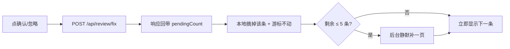

# 待确认页处理延迟改进（R17b）

> 起因：待确认页（Tab1，21,993 条待确认）点「确认 / 忽略 / 改判」后要等好几秒。
> 本文记录**诊断依据、改造方案、实测结果**，以及几个"看起来没事、其实在拖时间"的坑。
> 结论：一次点击从「1 次写 + 11 次串行读 + 1 次照片详情」降到「1 次写 + 0~1 次后台读」。

---

## 一、现象与证据

用户操作后，后端日志长这样（一次点击 = 一大串读）：

```
POST /api/review/fix                        200
GET  /api/review/pending?page=1&size=20     200
GET  /api/review/pending?page=2&size=20     200
...                                          （一路到 page=11）
GET  /api/photos/PH_eede3c08...             200
```

也就是说：**一次「忽略/改判」= 1 次写 + 11 次串行读 + 1 次照片详情**，
而且全部 await 完才推进到下一条。11 页 × 每页几百毫秒 ⇒ 秒级白屏。

## 二、慢在哪（两侧各占一半）

### 2.1 前端：写后整队重取 + 串行补页（把后端开销放大 11 倍）

`code/webserver/src/store/review.js`（改造前）：

- `fix()` 写成功后 `await fetchPending({ reset: true })` —— **整队从头重取**；
- `fetchPending({reset:true})` 里再 `await loadUntilFresh()`；
- `loadUntilFresh()` 是 `while(true){ pendingPage += 1; await fetchPending() }`，
  **串行**翻页直到 `pendingItems[cursor]` 不是"已跳过"的脸；
- 「跳过」只在本地把条目重排到数组末尾（`applyDeferOrder`），所以队首全是被跳过的脸时，
  只能靠"多拉几页"凑出一条干净的 —— 跳过越多、翻得越深。

### 2.2 后端：每一页都在重算，且没有任何缓存

`code/src/processor/review/queue.py`（改造前）：

| 环节 | 每次页请求的开销 | 说明 |
|---|---|---|
| `personCards()` | 全库人脸回扫 | `pb_person` 全表 light 扫；对**每个没设头像的人**逐个遍历其全部人脸找 detScore 最高者。本库几乎没人设 `avatarFaceCode` ⇒ 等于每页把 4 万张脸扫一遍 |
| `centroid.loadAllCentroids()` | 两遍全表扫 | 第二遍逐页取 2048B BLOB 填矩阵，**无缓存** |
| 取页 SQL | 2.2 万行排序 + 物化整行 | `SELECT * ... WHERE personCode IS NULL ORDER BY quality DESC LIMIT 20 OFFSET n`，`SELECT *` 含 2KB 向量，且没有索引支持 `ORDER BY quality` |
| `countPending()` | 全量 count | 每页都算，只为回一个总数 |

`code/src/api/review.py`：

- 写接口的 `_counts()` 调 `countStates()` = **4 个 count**（pending / disputed / confirmed / stranger），
  而前端只用前两个；`confirmed` / `stranger` 都是全表扫，各 ~110ms ⇒ **每次点击白付 220ms**；
- `withCentroidOf()` 为"新旧两人的全部质心桶"各查一次表，前端从不读这段明细。

**排除锁等待**：库是 WAL + 读写双连接（`common/sqliteHandle.py`），写不阻塞读，慢与并发互斥无关。

### 2.3 一句话归因

> 前端「写后整队重取 + 串行补页」× 后端「每页重算人物卡与质心、并对 2 万行排序」= 11 次 × 数百毫秒的串行等待。

## 三、实测基线（正式库快照：44,452 张脸 / 22,004 待确认 / 2,068 人）

用 `code/src/tools/profile_review_queue.py` 量（**只在库副本上跑**，脚本会拒绝正式库）：

| 环节 | 改造前 | 改造后 |
|---|---|---|
| `pendingQueue` 取一页（offset=0） | **234 ms** | **3.9 ms** |
| `pendingQueue` 取一页（offset=200） | 238 ms | 5.5 ms |
| `countPending()` | 60 ms | **0.8 ms** |
| `personCards()` | 88 ms（每次重算） | ~0（进程内缓存，首算一条聚合 SQL） |
| `loadAllCentroids()` | 37 ms（每次重算） | ~0（缓存 + 写后失效） |
| 写接口 `_counts()` | 307 ms（4 个 count） | **~8 ms**（2 个 count） |
| **一次点击的请求数** | 1 写 + **11 读** + 1 照片 | 1 写 + **0~1 读**（预取命中则 0） |

## 四、方案（三层）

### 4.1 前端：写后本地前进，不再整队重取

- 确认 / 忽略 / 改判成功后：把该条从本地缓冲**摘掉**、游标不动 = 立即显示下一条，**不发任何读请求**；
- 「跳过」改成把 faceCode 记进排除集（会话级、不写库），本地摘掉即刻前进，**0 请求**；
- 缓冲剩 ≤ `PENDING_LOW_WATER`(5) 条时**后台静默**补一页（不阻塞点击）；
- 换条后预取**下一条**的照片详情，大图不再等 `GET /api/photos/{code}`；
- 进度数改用写接口回带的 `pendingCount`（不再 `pendingTotal - doneCount` 双重扣减）。



### 4.2 后端：一次排除 + 缓存 + 精简响应

- `/review/pending` 新增 `excludeFaceCodes`（逗号分隔，去重，**超 500 静默截断不报错** ——
  它是 UI 侧会话参数，跳过多了返回 400 会让整页不可用）；
- 响应新增 `exhausted` / `scanCapped` / `excludeCount` / `scanned`：
  **"还有没有下一页"改看 `exhausted`**，不看 `items.length < total`
  （有排除集时后者永远成立，会无限翻页）；
- `queue.pendingWindow()`：扫描上限 `QUEUE_SCAN_ROWS_MAX=4000` 兜底，超了如实回报 `scanCapped`；
- `personCards()` 由「2068 人逐个回扫人脸」改成**一条聚合 SQL**（`isConfirmed=1 AND isStranger=0` 取最大 detScore）；
- `personCards()` 结果与 `(matrix, index)` 做**进程内缓存**（`Lock` + TTL 30s + `invalidateCaches()`），
  写接口（assign/batch/fix/merge/split/undo、换头像、软删/还原、自动匹配）与
  建档/改名/停用/启用/导入成功后**成对失效**；
- `_counts()` 降为 `countPending() + countDisputed()` 两个 count；
  `/review/pending/count` 仍返回四个数（有测试与验收依赖）；
- `fix` 新增 `withCentroid`（默认 1 保持兼容，前端逐条处理时传 0 省掉质心明细查询）。

### 4.3 数据库：一条覆盖索引

`code/src/database/sqliteCodeGenerator.py` 的 `INDEX_SPEC["pb_face"]` 新增：

```
idx_pb_face_isStranger_delFlag_quality
    列   : (isStranger, delFlag, quality)     ← 前两列是等值约束，第三列是排序键
    部分 : WHERE personCode IS NULL
```

查询计划变成
`SEARCH pb_face USING INDEX idx_pb_face_isStranger_delFlag_quality (isStranger=? AND delFlag=?)`
—— 过滤与排序全程不碰表（详见 §5.1）。

走 `tools/build_db --migrate` 应用（只加索引不动数据，正式库实测 0.15 秒）。

## 五、三个坑（都已写进代码注释，别再踩）

### 5.1 `quality` 是 `DECIMAL(6,4)`（NUMERIC 亲和性），SQLite 不用它满足 `ORDER BY`

浮点亲和性的列，索引项里存的是**数值**；`NUMERIC` 亲和性的列，索引项里可能存的是
**文本**（`'0.8'`/`'0.911'`）。要让 `ORDER BY quality DESC` 直接吃索引，SQLite 得能证明
"索引序 = 数值序"，文本序做不到 ⇒ 它宁可在索引项上再排一次（`USE TEMP B-TREE FOR ORDER BY`）。

所以这次省下的**不是"排序"本身**，而是"每页 2.2 万次随机回表"：

- 索引项里只有 `(quality, rowid)` ⇒ 排完还得回表取 `isStranger/delFlag` 判条件 ⇒ 每页 2.2 万次随机 IO（**72ms**）；
- 把 `isStranger/delFlag` 放进**索引列** ⇒ 排序只碰索引项、全程不回表，`LIMIT 20` 一到就停（**0.1ms 级**）。

⚠️ 别试图"改成 REAL 亲和性让 ORDER BY 吃索引"：那会改变数值的存储语义，
波及全部质量分相关的比较与导出。

### 5.2 部分索引的谓词**不能带绑定参数**

`WHERE delFlag = '0'` 写进索引谓词、而查询用 `delFlag = %s`（绑参）——
SQLite 要求谓词**语法等价**才启用索引，绑参永远匹配不上 ⇒ 索引**静默失效**（不报错、不告警）。
所以括号里只写 `personCode IS NULL`（查询侧是同一个字面谓词），`isStranger/delFlag` 交给索引列兜。

### 5.3 进程内缓存必须**按库文件路径分键**

`sqliteCommon.dbHandle(path)` 可以切库（单测每个用例一个新临时库、运维 `--db` 指别的库）。
只按 `"cards"` 存一份的话，切库后会把上一个库的人物卡/质心原样返回 ——
查询完全"成功"，只是答案是另一个库的。这个坑是单测先炸出来的（`test_pending_queue_sort_first_*` 与
`test_person_card_falls_back_to_confirmed_face` 同时变红），修法是缓存键带上 `dbFilePath()`。

另外：分页键必须构成**全序**。`ORDER BY quality DESC` 在并列值上"兜底顺序"
会随执行计划变化（覆盖索引反向扫是 `recID DESC`，别的计划是 `ASC`），
表现是"同一页内容顺序自己换"。现在 SQL 里写死 `, recID ASC`（实测只是最后一项走临时排序，0.1ms）。

## 六、改动清单

```
code/
├─ src/
│  ├─ tools/profile_review_queue.py        [NEW] 队列性能度量（逐项计时 + EXPLAIN QUERY PLAN，拒绝正式库）
│  ├─ processor/review/queue.py            [MODIFY] personCards 单条聚合 SQL；人物卡/质心进程内缓存
│  │                                       + invalidateCaches()；pendingWindow（排除集 + exhausted）；
│  │                                       取页改两段式（先 recID 再按 recID 回表，每批 64 行）
│  ├─ api/review.py                        [MODIFY] excludeFaceCodes / exhausted；_counts() 降为 2 个；
│  │                                       fix 加 withCentroid；写端点成对失效缓存
│  ├─ api/contacts.py                      [MODIFY] 建档/改名/停用/启用/导入后失效队列缓存
│  ├─ api/match.py / api/photoAction.py    [MODIFY] 自动归属、软删/还原后失效队列缓存
│  ├─ database/sqliteCodeGenerator.py      [MODIFY] INDEX_SPEC + EXPECTED_INDEX_NAMES 新增覆盖索引
│  ├─ database/auto_generated/sqliteCommon.py  [REGENERATE] 由生成器产出（不手改）
│  └─ test/test_api_review.py              [MODIFY] +4 用例：排除集不重不漏、全排除 exhausted、
│                                                   超限静默截断、改名后缓存即时失效
└─ webserver/
   ├─ scripts/check-review-queue.mjs        [NEW] `npm run check:review`：打桩 axios 数请求次数
   ├─ package.json                          [MODIFY] postbuild 增加 check:review
   └─ src/
      ├─ store/review.js                    [MODIFY] 删 loadUntilFresh/applyDeferOrder；写后本地前进；
      │                                       跳过→排除集；低水位静默预取；remaining 用服务端计数
      ├─ api/review.js                      [MODIFY] getPending 透传 excludeFaceCodes（数组→逗号串）；
      │                                       fixFace 支持 params（withCentroid=0）
      └─ views/ReviewView.vue               [MODIFY] 进度文案口径；下一条照片预取
```

## 七、验证

| 项 | 结果 |
|---|---|
| `pytest test/test_api_review.py test/test_dbscan.py test/test_review_ops.py` | **150 passed**（含新增 4 条） |
| 全量后端 `pytest test` | 1627 passed；5 failed / 27 error 均在 `test_place_*`（环境缺 `shapely`，与本次无关） |
| `npm run build` + postbuild 三道校验（style-order / avatar / review） | 全过 |
| `npm run check:review` | 17 项全过：10 次确认 = 10 PUT + **0 GET**；跳过 3 次 = **0 请求**；补页最多 1 次且带排除集 |
| 正式库 `build_db --migrate` | 新建索引 1 个，0.15 秒，未改动任何数据 |

## 八、还能做什么（本次没做）

| 事项 | 说明 |
|---|---|
| `confirmed` / `stranger` 两个 count | 已从写路径移出，但 `/review/pending/count` 仍全表扫（各 ~110ms，只在进页面时算一次）。真要快就再加一条 `(isConfirmed, isStranger, delFlag)` 覆盖索引 |
| 队列总数语义 | `pendingTotal` 与侧栏 `pendingCount` 现在是同一个数（都由 `countPending()` 出）。将来若要"总数含已跳过"，得单独给一个字段，别复用 |
| 前端的「已跳过」跨会话 | 目前仍是会话级（刷新即恢复），与设计稿一致；要持久化得动 `pb_review_log` 或 localStorage |
